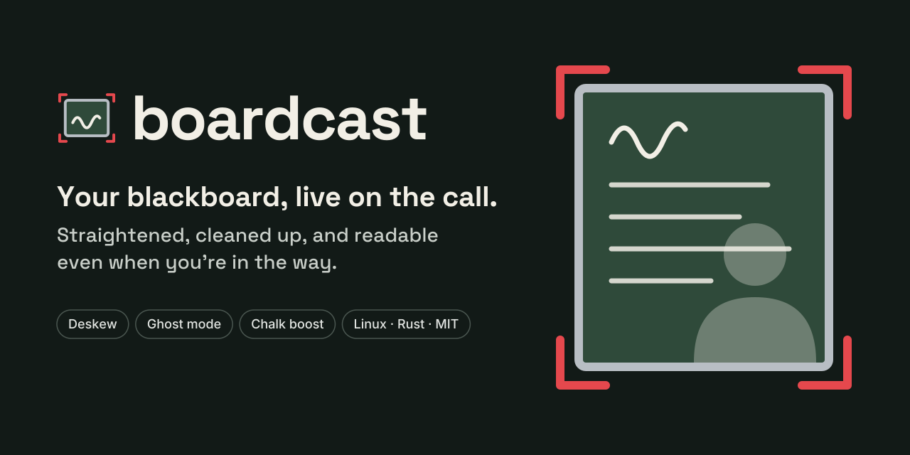
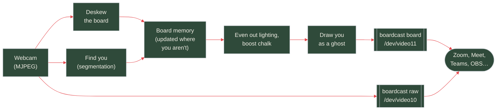

<p align="center">
  
</p>

<p align="center">
  <a href="LICENSE"></a>
  
  
  
</p>

# boardcast

**A virtual camera of your blackboard, for video calls.**

Teaching on a blackboard over a video call usually means a skewed, dim view of the board, with you standing in front
of the bit everyone is trying to read. boardcast sits between your webcam and your meeting app. It gives the app a new
camera that shows just the board: cut out, flattened, and cleaned up. When you step in front of the board, the
writing behind you stays visible, and you're drawn over it as a faint ghost.



**Contents:** [Features](#features) · [Requirements](#requirements) · [Quick start](#quick-start) ·
[Using it](#using-it) · [Configuration](#configuration) · [How it works](#how-it-works) ·
[Troubleshooting](#troubleshooting) · [License](#license)

## Features

- **Deskew**: the board is cut out of the camera picture and flattened to a rectangle, at the full resolution the
  camera can see it.
- **Ghost mode**: a person-segmentation model finds you; the board behind you is remembered from before you
  stepped in front of it, and you're blended over it at a chosen opacity (or hidden altogether).
- **Chalk enhancement**: uneven lighting is flattened and chalk strokes boosted. You can keep the board's colours or
  switch to dark ink on white paper.
- **Picture-in-picture**: an optional rounded inset of your face, which follows your head (found by a pose model),
  in a corner of the board feed.
- **Self-correcting**: if the camera gets bumped, boardcast finds the board's frame again and re-aligns by itself.
- **Focus helpers**: holds the lens at the board's focus, so autofocus doesn't chase you, and can find the sharpest
  setting for you.
- **Board light** (optional): turns a Home Assistant light on while it runs and off when it stops.

- **Two cameras**: the webcam is also passed through unchanged, so you can switch between the board and a normal
  view in your meeting app.

| Virtual camera  | Device         | What                                    |
|-----------------|----------------|-----------------------------------------|
| `boardcast board` | `/dev/video11` | the deskewed, cleaned-up board          |
| `boardcast raw`   | `/dev/video10` | the webcam as it is (1920×1080)         |

## Requirements

- **Linux** with [v4l2loopback](https://github.com/v4l2loopback/v4l2loopback) (Ubuntu ships it with the kernel;
  elsewhere install `v4l2loopback-dkms`).
- **A webcam that delivers MJPEG** (almost all USB webcams do). Higher resolution means a sharper board; a camera
  with manual focus control (`focus_absolute`) works best.
- **A board with a visible frame.** boardcast finds the board by the step in brightness from a dark writing surface to
  a lighter frame (for example a green chalkboard in an aluminium frame).
- **Rust** (edition 2024; install with [rustup](https://rustup.rs)) and `curl`. The optional pose model also needs
  [uv](https://docs.astral.sh/uv/).
- A few CPU cores: ghost mode uses about 2–2.5 cores at 15 fps. No GPU needed, but an NVIDIA GPU lets it segment
  every frame instead of 10 a second (see [segmenting on the GPU](#segmenting-on-an-nvidia-gpu)).

**Tested with** an Anker PowerConf C200 (2560×1440 MJPEG, mounted on its side) and a green chalkboard in an aluminium
frame, on Ubuntu with v4l2loopback 0.12.7. Other webcams and boards should work; reports are welcome in the issues.

## Quick start

**1. Build and install.**

```sh
git clone https://github.com/WillMatthews/boardcast && cd boardcast
cargo install --path .
```

**2. Create the virtual cameras** (needs sudo; once per boot, or see [loading at boot](#loading-v4l2loopback-at-boot)):

```sh
scripts/loopback.sh
```

**3. Download the models** to `~/.local/share/boardcast/models`:

```sh
scripts/fetch-model.sh       # person segmentation (Robust Video Matting, ~15 MB); needed for ghost mode
scripts/fetch-pose-model.sh  # optional: needed for the picture-in-picture (needs uv)
```

#### Segmenting on an NVIDIA GPU

Optional. On the CPU, segmentation takes ~45 ms a frame, so the ghost's matte updates 10 times a second. With CUDA it
takes ~8 ms (RTX 2060), so it updates on every camera frame, and you're cut out with that frame's own outline
rather than one a frame or two old. You need an NVIDIA driver for CUDA 13 (r580 or later;
see `nvidia-smi`). Then:

```sh
scripts/fetch-cuda.sh   # CUDA 13 + cuDNN 9 runtime libraries from NVIDIA's PyPI wheels (~1 GB download, 1.7 GB unpacked)
cargo build --release --features cuda
# ONNX Runtime's CUDA provider libraries must sit next to the binary:
install -m755 target/release/boardcast target/release/libonnxruntime_providers_{shared,cuda}.so ~/.cargo/bin/
```

The libraries go to `~/.local/share/boardcast/cuda`. When the GPU can't be used, boardcast says why and segments on
the CPU. `--seg-cpu` forces the CPU, and `--seg-fps` still caps the rate.

**4. Set up the camera.** With the board in view:

```sh
boardcast setup                # add --rotate 90 (or 180, 270) if your camera is mounted on its side
```

This writes a starting config to `~/.config/boardcast/board.json`, and `setup.png`, which is the camera's view with a
pixel grid over it.

**5. Find the board.** Open `setup.png`, read off the board's four corners roughly (to within about 50 px), and pass
them in order: the board's top-left first, then clockwise (top-right, bottom-right, bottom-left). For example:

```sh
boardcast calibrate --from "960,200 1790,195 1805,800 965,820"   # use your own numbers
```

> [!TIP]
> If the camera is on its side, the picture in `setup.png` is sideways. List the corners starting from **the
> board's** top-left, wherever that ends up in the picture.

boardcast finds the exact edges of the board near those points, saves them, and writes `calib.png` with the result
outlined in green. Check it.

**6. Focus on the board.** Stand aside and run:

```sh
boardcast focus                # sweeps the lens for about half a minute and saves the sharpest setting
```

**7. Go.**

```sh
boardcast
```

In your meeting app, pick the camera called **boardcast board**. Press `q` (or Ctrl-C) to stop.

> [!NOTE]
> The virtual cameras only appear in meeting apps while boardcast is running.

To check the setup without a meeting, `boardcast snap out/` saves a still of the board in each look.

## Using it

While it runs, boardcast shows a status display in the terminal: the feeds (and whether any app is watching them), the
look and ghost settings, focus and sharpness, board tracking, frame rate and CPU, and a log.

### Keys

| Key | What |
|---|---|
| `g` | step how much of you is shown: hidden → ghost 0.1 → 0.25 → 0.5 → opaque |
| `l` | cycle the look: plain → natural → paper |
| `p` | picture-in-picture on / off; `o` moves it to the next corner |
| `d` | debug view of the board memory (see below) |
| `f` | switch between the board's focus and autofocus |
| `,` / `.` | move the board focus nearer / further (saved a couple of seconds after you stop) |
| `b` | board light on / off; `-` / `=` dim / brighten; `k` steps the colour temperature |
| `q`, Esc, Ctrl-C | stop |

### Looks

| Look | What |
|---|---|
| `natural` (default) | lighting evened out, chalk boosted, the board's colours kept |
| `paper` | dark ink on white, chalk only (sticky notes and chalk-dust haze become paper); clearest in poor light |
| `plain` | the board as the camera sees it |

### Debug view

`d` swaps the board feed for a map of what the board memory is doing at each pixel, over a dim grey copy of the
memory. The status display shows what share of the board is in each state.

| Colour | What |
|---|---|
| blue | you (the segmentation matte); frozen |
| magenta | held: the grown matte around you, and its hold after you move, fading as it decays; frozen |
| violet | your cast shadow: clearly darker than the bare board while you're in view; frozen |
| red → yellow | a big change (new chalk, erasing) waiting for the pixel to keep still; yellow is nearly there |
| green | a big change going into memory now |
| cyan | a small change creeping in at the slow rate (faint chalk, a soft shadow edge) |
| none | matches the memory |

### Common options

```sh
boardcast --look paper              # start in the paper look
boardcast --ghost-opacity 0.4       # make yourself more visible
boardcast --no-ghost                # plain deskewed board: no segmentation, much less CPU
boardcast --pip                     # start with the picture-in-picture on
boardcast --no-raw                  # don't provide the passthrough camera
boardcast --size 1920x1080          # pad the board into a fixed 16:9 frame (default: the board alone)
boardcast --cam /dev/video2         # a different webcam
```

`boardcast --help` lists everything, and `boardcast <command> --help` covers each command.

### Focus

Autofocus locks onto whoever is in front of the board, so boardcast holds the lens at the board's focus from the
config. `boardcast focus` finds it automatically. Stand aside while it runs: it sweeps the lens and scores how sharp
the deskewed board is at each step. While streaming, the status display shows the live sharpness score next to the
focus. Use it to compare lighting or camera settings, but only compare scores taken in the same light, and note that
in-camera sharpening inflates it.

### Picture-in-picture

A rounded crop of you, inset in a corner of the board feed. It doesn't change the feed's resolution, so meeting apps
don't notice it coming and going. It follows your head and frames you the same whether you're at the board or close
to the camera, and it fades out when you leave. It finds your head with a YOLO pose model, even when your back is
turned or your arms are raised, so it needs that model (`scripts/fetch-pose-model.sh`) as well as ghost mode. When
you move it with `o`, it glides to the next corner. Use `--pip-size` (a fraction of the feed's width, default 0.3)
and `--pip-corner` to set it up.

### Board light (optional)

boardcast can turn a light on while it runs and off when it stops, through
[Home Assistant](https://www.home-assistant.io/). Copy `light.example.json` to `~/.config/boardcast/light.json` and
fill in your Home Assistant URL, the light's entity id, and the `light.turn_on` service data to use while running.
The API token is read from `HA_API_KEY` in the environment, or from a `HA_API_KEY=...` line in `~/.tokens`. Without
`light.json`, or with `--no-light`, the light is left alone.

## Configuration

| File | What |
|---|---|
| `~/.config/boardcast/board.json` | camera resolution, board corners, focus, rotation (written by `setup`, `calibrate`, `focus`) |
| `~/.config/boardcast/light.json` | board light (optional) |
| `~/.local/share/boardcast/models/` | the ONNX models |

These follow `XDG_CONFIG_HOME` and `XDG_DATA_HOME` when set. Use `--config` to use a different board file, for
example one per room.

`board.json`:

- `frame`: the camera resolution, `[width, height]`.
- `corners`: the board's writing surface (the inner edge of its frame), as top-left, top-right, bottom-right,
  bottom-left, in camera pixels.
- `rotate`: degrees to turn the camera picture clockwise to make it upright (0, 90, 180, 270), for a camera mounted
  on its side. Corners are always listed in the board's own order (its top-left first), so the board comes out
  upright; the raw feed is turned upright too (portrait, e.g. 1080×1920).
- `focus`: the locked `focus_absolute` value. Leave it out for autofocus.
- `aspect`: the board's real width ÷ height. If you leave it out, it's estimated from the corners, but perspective
  makes that a guess, so measure your board.

### Calibration

```sh
boardcast calibrate                        # the camera moved a little: find the board near the saved corners
boardcast calibrate --dry-run              # find it and write calib.png, but change nothing
boardcast calibrate --search 250           # the camera moved a lot (default search: 120 px)
boardcast calibrate --from "x,y x,y x,y x,y"   # start from rough corners (top-left, top-right, bottom-right, bottom-left)
boardcast calibrate --set "x,y x,y x,y x,y"    # manual fallback: use exactly these corners, no detection
```

`calib.png` shows the new outline in green and the
previous one in orange. boardcast refuses to save an outline that can't be the board (a corner outside the picture, a
shape that isn't board-like, or an edge suddenly 1.6× longer or shorter), for example when part of the board is out
of view and a straight chalk line looks like an edge. It prints the rejected corners so you can accept them with
`--set` if `calib.png` shows they're right.

**While streaming**, boardcast follows small camera bumps by itself (see [How it works](#how-it-works)). If the board
moved further than tracking can follow, it prints a hint to run `calibrate`. `--no-track` turns tracking off.

## How it works

<details>
<summary><b>Ghost mode</b>: remembering the board behind you</summary>

- A worker thread runs [Robust Video Matting](https://github.com/PeterL1n/RobustVideoMatting) on a 512×288 copy of
  the newest frame, at most 10 times a second (about 55 ms each on a CPU). It publishes the newest matte, and the
  video loop never waits for it. On the GPU, segmentation starts as soon as a frame arrives, runs while the board
  is being deskewed, and the ghost waits (up to 30 ms) for that frame's matte, so you're cut out where you are now.
- The matte is warped into board space, grown by 2.5% of the board height, and held for a few frames after you
  move, so the board memory never learns you.
- The board memory is a per-pixel running average, updated only where you aren't. Small differences update slowly,
  which removes noise from faint chalk. Big ones (new chalk, erasing) are only accepted once a pixel has been still
  for about 1/3 s, so a moving hand that the matte missed is never absorbed. Accepted changes appear in about half a
  second.
- Your shadow falls outside the matte and keeps as still as you do, so stillness alone would let it in. While
  you're in view, a pixel that has gone clearly darker than the bare board around it (under 0.8× a coarse estimate
  of the board's brightness) is treated as shadow and not learned. Erasing still goes in, because wiped chalk
  returns to about the board's own brightness. Chalk under the shadow can stay brighter than bare board, so any
  darkening within a few pixels of a shadow is held too (strokes are thin, so there is always shadowed board beside
  them). The threshold follows the room light (how much the whole board has dimmed or brightened), so changing
  the lights isn't mistaken for a shadow. A faint shadow can stay above the threshold, so soft, diffuse light from
  the front (rather than one lamp off to the side) still gives the cleanest board. The debug view (`d`) shows held
  shadow in violet.
- Output: the memory, with the live frame blended in at `--ghost-opacity` where the matte says there's a person.

</details>

<details>
<summary><b>Chalk enhancement</b>: evening out the light</summary>

Chalk is found with a white top-hat, which is the image minus its morphological opening and
keeps only bright strokes thinner than about 11 px. Large bright areas like sticky notes and haze therefore aren't
treated as ink. Lighting is estimated as a coarse median, refreshed twice a second, and divided out, with the gain
capped at 3× so unlit corners don't turn to noise. In ghost mode, enhancement runs at about 10 Hz on the slowly
changing board memory, and you're drawn on top every frame.

</details>

<details>
<summary><b>Finding the board</b>: calibration and tracking</summary>

Along each edge of the starting outline, boardcast looks across the edge for the strongest step from dark board to
bright frame. It fits a line to each edge with RANSAC, so sticky notes on the edge, a person in front of it, or chalk
near it are ignored, and intersects the lines to get the corners.

While streaming, boardcast re-checks the edges every 2 s (an average of 8 frames, ±15 px). If three checks in a row
agree that the board has moved by more than 2 px, it re-aligns, restarts the board memory, and saves the new
corners. The output size stays the same, so meeting apps don't notice.

</details>

**Cost.** The raw feed is only produced while another program has it open (checked once a second), so it costs
nothing when unused. Typical CPU at 15 fps is about 2.2 cores, or 2.65 with the raw feed being watched.

## Troubleshooting

**The cameras don't show up in my meeting app.** They only appear while boardcast is running (because of
`exclusive_caps`, which Chrome and Meet need). Check that the module is loaded with
`v4l2-ctl --list-devices | grep -A1 boardcast`.

**`setting MJPEG ... on /dev/video0` fails.** Another program is using the webcam. `fuser /dev/video0` shows which
one. boardcast holds the webcam while it runs, so other programs can't use it at the same time; use the
**boardcast raw** camera instead.

**`setting YUYV ... Invalid argument`.** The v4l2loopback driver is stuck. This happens on 0.12.7 if something writes
to an `exclusive_caps` device with plain `write()` calls (e.g. ffmpeg, or `boardcast --io write`) and then exits.
Reload the module with `scripts/loopback.sh`.

**`calibrate` can't find the board.** Make sure the whole board is in view, give rougher corners closer to the real
ones with `--from`, or widen `--search`. As a last resort, set the corners by hand with `--set`.

### Loading v4l2loopback at boot

<details>
<summary>The module options, and how to load it at every boot</summary>

`scripts/loopback.sh` (re)loads the module with these options:

```sh
sudo modprobe v4l2loopback devices=2 video_nr=10,11 \
    card_label="boardcast raw","boardcast board" exclusive_caps=1,1 max_buffers=8
```

| Option | Why |
|---|---|
| `devices=2 video_nr=10,11` | two devices at fixed paths: `/dev/video10` (raw) and `/dev/video11` (board) |
| `card_label=...` | the names meeting apps show in their camera picker |
| `exclusive_caps=1,1` | **one value per device.** The devices advertise capture-only while boardcast is writing, which Chrome and Meet need to list them |
| `max_buffers=8` | boardcast fills buffers in rotation, so readers get up to 7 frames of slack before a frame they're copying is overwritten (tearing). The default of 2 gives one frame |

To load it at every boot:

```sh
echo v4l2loopback | sudo tee /etc/modules-load.d/boardcast.conf
echo 'options v4l2loopback devices=2 video_nr=10,11 card_label="boardcast raw","boardcast board" exclusive_caps=1,1 max_buffers=8' \
    | sudo tee /etc/modprobe.d/boardcast.conf
```

If you change the device numbers, pass them to boardcast with `--raw` and `--board`.

</details>

## License

boardcast is MIT licensed (see [LICENSE](LICENSE)). The models it downloads have their own licenses and aren't part
of this repository:

- [Robust Video Matting](https://github.com/PeterL1n/RobustVideoMatting): GPL-3.0
- [Ultralytics YOLO11 pose](https://github.com/ultralytics/ultralytics): AGPL-3.0

The boardcast logo and banner are in [`assets/`](assets/). The wordmark is set in
[Space Grotesk](https://fonts.google.com/specimen/Space+Grotesk) (OFL).
